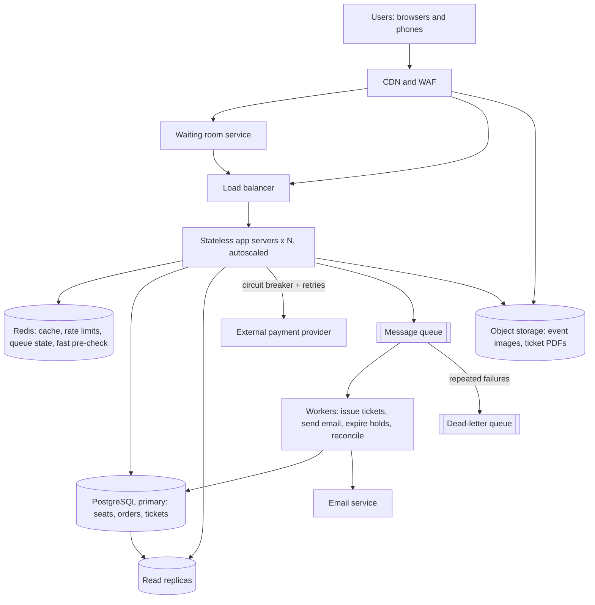

# TicketHub: Design Document

**Status:** Final draft for review

## 1. Context

TicketHub is a website that sells tickets for concerts and events. Fans browse events, pick seats, pay online and receive a ticket they can show at the door. Organisers list events and want them to sell out smoothly.

The hard part is **launch day**. On a normal day the site is quiet, but when a very popular concert goes on sale, a huge crowd competes for a small number of seats at the same moment. Two things must hold even then: the site must not fall over, and **no seat may ever be sold to two people**.

**Terms used in this document**

- **Seat hold:** a temporary, time-limited reservation of a seat while its buyer pays.
- **Transaction:** a group of database steps that either all succeed or all fail together.
- **Idempotency key:** a unique value sent with a request so that repeating the request (for example after a network retry) has the same effect as sending it once.
- **Waiting room:** a queue that lets users into the buying flow at a controlled rate instead of all at once.
- **Circuit breaker:** a safety switch that stops calling a failing service for a short time, so failures do not pile up.
- **Dead-letter queue (DLQ):** a holding queue for messages that repeatedly failed to process, so they can be inspected and retried without being lost.
- **RPS:** requests per second.

## 2. Goals and non-goals

**Goals**

- Browse and search events, and see which seats are available.
- Select seats, hold them, pay and receive tickets.
- Never sell the same seat twice.
- Stay available for browsing during a sale, and keep the buying flow correct and responsive.
- Fail safely: a problem in one part (for example the payment provider) must not corrupt orders or double-sell seats.

**Non-goals (deliberately left out of this version)**

- Ticket resale or transfer marketplace. It adds ownership history and fraud rules.
- Dynamic or auction pricing. Prices are fixed per seat category.
- Refund and cancellation workflow for customers. Orders are final, apart from automatic refunds when we cannot deliver a ticket.
- Multi-currency and tax handling. One currency is assumed.
- Building our own payment processor. We use an external payment provider so that we never store card numbers.

## 3. Requirements and estimates

### Functional requirements

1. Users can register, log in and view their profile.
2. Users can search and list events and view event details.
3. Users can view a seat map showing which seats are available.
4. During a high-demand sale, users enter a waiting room before they can select seats.
5. Users can hold one or more seats for a limited time.
6. Users can pay for held seats and receive tickets with a QR code.
7. Users can view their purchased tickets.
8. Held seats that are not paid for are released automatically when the hold expires.
9. If something fails after payment (for example ticket creation), the system retries, and if it cannot recover, refunds the customer automatically.

### Non-functional requirements

| Requirement | Target | Why it matters |
|---|---|---|
| Correctness / consistency | A seat is sold to at most one buyer, always | Core business rule |
| Speed (latency) | p95 under 300 ms for browsing on a normal day; seat hold under 500 ms | Feels responsive |
| Availability | Browsing 99.9%; buying flow degrades gracefully (users wait) rather than errors | Revenue and trust |
| Fairness | Users are admitted in roughly first-come order | Public trust in a sale |
| Durability | Paid orders and issued tickets are never lost | Money was taken |
| Resilience | Failure of the payment provider, cache or a worker does not cause double sales or lost orders | Keeps money and seats consistent |
| Security | No card data stored by us; rate limiting and bot protection | Fraud and compliance |

### Estimates

All figures are rounded. The point is the order of magnitude and what it implies.

**Normal day**

| Quantity | Working | Result |
|---|---|---|
| Page views per day | 50,000 visitors x 10 pages | 500,000 |
| Average page RPS | 500,000 / 86,400 s | about 6 RPS |
| Peak page RPS | x 3 (traffic is concentrated in the evening) | about 20 RPS |
| Tickets sold per day | given | 5,000 |
| Average purchase rate | 5,000 / 86,400 s | about 0.06 per second |
| New ticket data per year | 5,000 x 365 x about 0.5 KB | about 1 GB |
| User data | 2,000,000 x about 1 KB | about 2 GB |

*So what:* a normal day is tiny. One small database handles it easily, and storage is not a concern. Nothing about normal traffic would force the architecture below.

**Popular on-sale (200,000 people, 20,000 seats, first 10 minutes)**

| Quantity | Working | Result |
|---|---|---|
| Arrival rate | 200,000 users / 600 s | about 330 users/s on average |
| Requests per user | about 10 (page, seat map, queue polls, hold, checkout) | about 2,000,000 requests |
| Average RPS | 2,000,000 / 600 s | about 3,300 RPS |
| Peak RPS | x 3 (most people arrive at the first second) | about 10,000 RPS |
| Spike vs normal peak | 10,000 / 20 | about 500x |
| Demand vs supply | 200,000 / 20,000 | 10 people per seat |
| Seat hold attempts (worst case) | 200,000 over 10 min, front-loaded x 3 | about 1,000 per second peak |

*So what:* the spike is about 500 times a normal day, and it is a short burst, not a steady load. We should not size the whole system for it permanently. We need to absorb it (CDN, cache, waiting room) and protect the database, which is the one component that must stay strongly consistent. Because 90% of the crowd will not get a seat, most of those 10,000 RPS should be answered cheaply without touching the database.

## 4. Proposed design

### 4.1 API

All endpoints return JSON. Authenticated endpoints use a bearer token. Errors use the form `{"error": "short_code", "message": "human readable text"}`.

| Method | Endpoint | Purpose | Success | Errors |
|---|---|---|---|---|
| POST | `/auth/login` | Log in, receive a token | 200 | 401 wrong credentials, 429 too many attempts |
| GET | `/events?q=&page=` | Search and list events | 200 | 400 bad query |
| GET | `/events/{id}` | Event details | 200 | 404 unknown event |
| GET | `/events/{id}/seats` | Seat map with availability | 200 | 404 unknown event |
| POST | `/events/{id}/queue` | Join the waiting room for a high-demand sale | 202 with a queue token and position | 404, 429 |
| POST | `/events/{id}/holds` | Hold one or more seats | 201 with hold id and `expires_at` | 403 not admitted from the waiting room, 409 a seat is already taken, 422 invalid seats or too many seats, 429 |
| DELETE | `/holds/{id}` | Release a hold early | 204 | 404, 403 not your hold |
| POST | `/orders` | Pay for a hold. Requires an `Idempotency-Key` header | 201 with order and tickets | 402 payment declined, 404 unknown hold, 409 hold belongs to someone else, 410 hold expired, 503 payment provider temporarily unavailable (safe to retry) |
| GET | `/users/me/tickets` | List my tickets | 200 | 401 |

**Example: hold seats**

Request:

```http
POST /events/42/holds
Authorization: Bearer <token>
Content-Type: application/json

{ "seat_ids": [1201, 1202] }
```

Response `201 Created`:

```json
{
  "hold_id": "h_9f3a",
  "event_id": 42,
  "seat_ids": [1201, 1202],
  "expires_at": "2026-11-05T19:05:00Z"
}
```

If someone else already holds seat 1202, the response is `409 Conflict` with `{"error": "seat_unavailable", "message": "Seat 1202 is no longer available", "seat_ids": [1202]}`, and seat 1201 is **not** held either (all-or-nothing).

**Why these choices**

- Nouns in URLs, with methods carrying the action (RESTful).
- `409` for a seat race, `410` for an expired hold, `402` for a declined payment, `429` for rate limiting and `503` for a temporary payment outage, so clients can react correctly to each case.
- `POST /orders` takes an idempotency key so that a retry after a timeout cannot charge the user twice.

### 4.2 Data model

Relationships: a **venue** has many **seats**. An **event** takes place at one venue. Each event has one **event_seat** row per seat in the venue (the inventory). A **user** places many **orders**. An **order** has one **payment** and many **tickets**. Each ticket points to one event seat.

| Table | Columns (type, constraints) |
|---|---|
| `users` | `id` BIGINT PK; `email` VARCHAR(255) NOT NULL UNIQUE; `password_hash` VARCHAR(255) NOT NULL; `created_at` TIMESTAMPTZ NOT NULL DEFAULT now() |
| `venues` | `id` BIGINT PK; `name` VARCHAR(200) NOT NULL; `city` VARCHAR(100) NOT NULL |
| `seats` | `id` BIGINT PK; `venue_id` BIGINT NOT NULL FK to venues; `section` VARCHAR(20) NOT NULL; `row_label` VARCHAR(10) NOT NULL; `seat_number` INT NOT NULL; UNIQUE (`venue_id`, `section`, `row_label`, `seat_number`) |
| `events` | `id` BIGINT PK; `venue_id` BIGINT NOT NULL FK to venues; `title` VARCHAR(200) NOT NULL; `starts_at` TIMESTAMPTZ NOT NULL; `on_sale_at` TIMESTAMPTZ NOT NULL; `high_demand` BOOLEAN NOT NULL DEFAULT false |
| `event_seats` | `event_id` BIGINT FK to events; `seat_id` BIGINT FK to seats; `price_cents` INT NOT NULL CHECK (price_cents >= 0); `status` VARCHAR(10) NOT NULL CHECK (status IN ('available','held','sold')) DEFAULT 'available'; `held_by` BIGINT NULL FK to users; `hold_id` VARCHAR(40) NULL; `hold_expires_at` TIMESTAMPTZ NULL; PRIMARY KEY (`event_id`, `seat_id`) |
| `orders` | `id` BIGINT PK; `user_id` BIGINT NOT NULL FK to users; `event_id` BIGINT NOT NULL FK to events; `idempotency_key` VARCHAR(64) NOT NULL; `total_cents` INT NOT NULL; `status` VARCHAR(10) NOT NULL CHECK (status IN ('pending','paid','failed','refunded')); `created_at` TIMESTAMPTZ NOT NULL DEFAULT now(); UNIQUE (`user_id`, `idempotency_key`) |
| `payments` | `id` BIGINT PK; `order_id` BIGINT NOT NULL UNIQUE FK to orders; `provider_ref` VARCHAR(100) NOT NULL; `amount_cents` INT NOT NULL; `status` VARCHAR(10) NOT NULL |
| `tickets` | `id` BIGINT PK; `order_id` BIGINT NOT NULL FK to orders; `event_id` BIGINT NOT NULL; `seat_id` BIGINT NOT NULL; `qr_code` VARCHAR(100) NOT NULL UNIQUE; `issued_at` TIMESTAMPTZ NOT NULL DEFAULT now(); **UNIQUE (`event_id`, `seat_id`)**; FK (`event_id`, `seat_id`) to `event_seats` |

**Why a relational database.** The data is highly structured with clear relationships, and the most important rule (a seat is sold once) is best enforced by database constraints and transactions rather than application code alone. Money amounts are stored as integer cents to avoid rounding errors. Indexes: `events(starts_at)`, `events(title)` for search, `orders(user_id)`, and `event_seats(event_id, status)` to count and list available seats.

### 4.3 Architecture



Every component exists because of a specific problem:

| Component | Problem it solves | Why this and not nothing |
|---|---|---|
| **CDN and WAF** | 500x traffic spike on static pages, images and the event page; bots and abusive traffic | Serves most spike requests without reaching our servers; filters obvious abuse early |
| **Waiting room** | 200,000 people arriving at once would overwhelm the seat-selection flow and the database | Admits users at a controlled rate (for example a few thousand at a time) so the buying flow sees a steady, safe load, and it is fair (first come, first admitted) |
| **Load balancer** | One app server is a single point of failure and cannot carry spike load | Spreads requests across servers and removes unhealthy ones |
| **Stateless app servers (autoscaled)** | Load varies by 500x between normal days and sales | Because they hold no state, we can add servers before a sale and remove them after |
| **Redis** | Repeated reads of the same event pages and seat maps; rate-limit counters and queue positions must be shared across servers; cheap rejection of repeat attempts for a seat that was just taken | In-memory speed protects the database; shared counters make rate limiting work across all servers. Redis never grants a seat, only the database does |
| **PostgreSQL primary** | Seat inventory must be strongly consistent so a seat is never sold twice | The single source of truth, with constraints and transactions |
| **Read replicas** | Browsing and seat maps are read-heavy | Take read traffic off the primary so it can focus on holds and orders |
| **Message queue and workers** | Ticket creation, email, hold cleanup and reconciliation should not make the buyer wait or be lost if a step fails | Work is retried safely and handled outside the request path |
| **Dead-letter queue** | A message that keeps failing (for example a corrupt order) would block the queue or be silently lost | Parks it for inspection and manual or automatic retry, and raises an alert |
| **External payment provider (behind a circuit breaker)** | Handling card data is risky and heavily regulated, and the provider can be slow or down | Cards never touch our systems; the circuit breaker stops us hammering a failing provider and keeps the rest of the site healthy |
| **Object storage** | Images and ticket files are large and do not belong in the database | Cheap, durable, and served through the CDN |

### 4.4 How the design prevents two people buying the same seat

This is enforced in **several independent layers**, so that a bug in one does not cause a double sale. The last layer is the database itself.

1. **Waiting room limits the contention.** Only admitted users can call `POST /holds` (otherwise `403`). This keeps hold attempts at a rate the database handles well, but it is a performance measure, not the safety guarantee.

2. **Optional Redis fast pre-check (can only reject).** Before touching the database, the app may try `SET seat:{event}:{seat} {user} NX EX 300` (an atomic "set if not exists" with a 5-minute expiry). If it fails, someone else very recently grabbed that seat, so we answer `409` immediately without a database call. This saves database work during the spike. It is **never** the authority: if the pre-check passes, or Redis is down, the request still goes to the database, which makes the real decision. The key is deleted when the hold is released or the order completes.

3. **Atomic hold using a conditional update inside a transaction.** A hold is a single SQL statement that succeeds only if the seat is free (or its old hold has expired):

   ```sql
   UPDATE event_seats
   SET status = 'held', held_by = :user, hold_id = :hold,
       hold_expires_at = now() + interval '5 minutes'
   WHERE event_id = :event AND seat_id = :seat
     AND (status = 'available'
          OR (status = 'held' AND hold_expires_at < now()));
   ```

   An `UPDATE` takes a **row-level lock** on the row it changes. If two people try for the same seat at the same instant, the second one waits for the first to finish, then re-checks the `WHERE` condition against the new row. The seat is no longer `available`, so the second statement updates 0 rows and that user gets `409 Conflict`. This works under PostgreSQL's default **READ COMMITTED** isolation level, because the re-check happens after the lock is released. When several seats are requested, all updates run in one **transaction** and the whole hold is rolled back if any seat updates 0 rows (all-or-nothing). Seats are always updated in ascending `seat_id` order so two transactions cannot deadlock each other. An equivalent alternative is `SELECT ... FOR UPDATE` followed by an `UPDATE`, but the single conditional statement is simpler and holds the lock for less time.

4. **Checkout verifies the hold.** `POST /orders` runs inside one transaction. It confirms that the hold still belongs to this user and has not expired (`410` if expired, `409` if not theirs), then marks the seats `sold` and creates the tickets. The payment is charged only after the hold is confirmed valid, and the hold lasts long enough (5 minutes) that it should not expire mid-payment. If it does expire during payment and the seat has been re-held by someone else, the payment is refunded automatically and the order is marked `failed`.

5. **Database backstop.** `tickets` has `UNIQUE (event_id, seat_id)`. Even if every earlier check had a bug, the database would reject a second ticket for the same seat, and the transaction would fail instead of double-selling.

6. **Idempotency.** `orders` has `UNIQUE (user_id, idempotency_key)`, so a retried request returns the original order instead of buying again.

7. **Expiry cleanup.** A worker runs every minute and releases expired holds (`status = 'available'`, clearing `held_by`, `hold_id` and `hold_expires_at`). Seats become buyable again even if no one touches them. The conditional update above also treats an expired hold as free, so correctness never depends on the worker being on time.

The cache is **never** used to grant a seat. A stale seat map may show a seat as free when it was just taken, which only costs the user a `409` and a refreshed map. The database is always the final authority.

### 4.5 Failure handling

A design that only works on the happy path is not production-ready. These are the main failures and how the system responds.

| Failure | What happens | Design response |
|---|---|---|
| **Payment provider is slow or down** | Checkout requests pile up and threads are exhausted | Short timeouts and a **circuit breaker**: after repeated failures, calls stop for a short period and users get `503` with "try again shortly" while their hold is kept (and optionally extended once). Safe retries with exponential backoff use the same idempotency key, so the user is never charged twice |
| **Payment succeeds but ticket creation fails** | Customer paid but has no ticket | The order stays `pending`; a worker retries ticket creation. After repeated failures the message goes to the **dead-letter queue** and an alert is raised. A **reconciliation job** compares paid payments with issued tickets and refunds or fixes any mismatch |
| **Worker crashes mid-task** | A task is half done | Tasks are idempotent and acknowledged only after success, so the queue redelivers them and a repeat does no harm |
| **Redis is down** | No fast pre-check, no shared rate limits | The system falls back to the database for correctness. Rate limiting falls back to per-server limits and the waiting room admits fewer users, so the database is still protected. Browsing slows but still works |
| **Hold lost while the user is picking or paying** | The user's seat was released or taken | The client shows a countdown. On `409` or `410` the **UI rolls back its selection**, refreshes the seat map and shows a clear message ("That seat was just taken. Please choose another.") instead of failing silently |
| **Database primary fails** | Holds and orders cannot be written | Automatic failover to a standby. Browsing continues from replicas and cache. Because all writes are transactional, a failover does not leave half-finished orders |

## 5. Alternatives considered

**Trade-off 1: Strong consistency in a relational database vs. a faster, eventually consistent store (for example a NoSQL store or only Redis).**
We chose PostgreSQL as the source of truth for seat state, accepting that a single primary limits write throughput. This is acceptable because the waiting room caps hold attempts to about 1,000 per second at peak, which a single primary handles, and conditional updates on different seats do not contend with each other. A purely eventually consistent store could scale writes further but would make double sales possible unless we added our own locking, which is risky for something this important. Redis alone was rejected as the inventory store because losing its data in a failure could lose sold-seat state.

**Trade-off 2: Waiting room vs. letting everyone in and scaling to the spike.**
We chose a waiting room, accepting that most users will wait and that it is an extra component to build and operate. The alternative is to scale app servers and the database for 10,000 RPS. That would be expensive, idle 99% of the time, and would still leave the database as the bottleneck since the contention is on the same 20,000 rows. A waiting room also gives users a clear and fair experience instead of random errors and timeouts.

**Trade-off 3: Seat holds with a timeout vs. reserving only at payment.**
We chose holds, accepting that unpaid holds temporarily lock seats (we will see some abandoned holds, and 10 people compete for each seat). Without holds, users could pick seats and pay only to be told the seat is gone, which is a worse experience and means failed payments to refund. A 5-minute timeout balances the two: short enough that abandoned seats come back quickly, long enough to type payment details.

**Trade-off 4: Cached seat maps vs. always reading fresh data.**
We chose to serve seat maps from the cache with a very short expiry (a few seconds), accepting that a user occasionally clicks a seat that was just taken. This takes enormous read load off the database during a sale, and correctness is protected by the hold step, which always checks the database.

**Trade-off 5: Redis lock as a fast pre-check only, vs. Redis as the lock owner.**
We chose to use Redis `SET NX` only to reject early, accepting that we still make a database call for every request that passes the pre-check. Making Redis the real lock would be faster, but a Redis crash, failover or expired key could allow two buyers to believe they own a seat, so correctness would depend on a component that is not our source of truth.

**Alternative: Pessimistic locking (`SELECT ... FOR UPDATE`) instead of a conditional update.** It also works, but it holds locks longer and needs two statements. The single conditional `UPDATE` is simpler and faster for the same guarantee.

**Alternative: One serialised queue per event that assigns seats one at a time.** Very safe, and a good option at much larger scale, but it adds complexity and reduces concurrency. At this scale the database constraints are enough.

## 6. Risks and open questions

| Risk | Impact | Mitigation |
|---|---|---|
| Bots and scalpers buy seats faster than real fans | Unfair sale, reputational damage | Rate limiting per user and IP, bot challenges at the waiting room, per-account seat limits (for example 4 seats), login required to enter the queue |
| Payment succeeds but ticket creation fails | Customer paid without tickets | Idempotency key, retries from the queue, dead-letter queue with alerts, and a reconciliation job that matches payments to tickets and refunds any mismatch |
| Payment provider outage during a sale | Nobody can complete a purchase | Circuit breaker, clear "try again" messaging, hold extension once, and a status page; consider a second provider later |
| Hold expires while the user is paying | Payment taken for a seat someone else now holds | Re-check the hold before charging; automatic refund if the seat was lost; show a countdown timer in the UI |
| Waiting room fails or is bypassed | Database overloaded by spike | Admission token is verified server-side on every hold request; rate limiting as a second line of defence; load test before launch |
| Database primary fails during a sale | Buying flow unavailable | Automatic failover to a standby; browsing continues from replicas and cache; test failover before big sales |
| Cache or Redis shows stale data or is unavailable | Users click taken seats and get a 409, or lose fast rejection | Short cache expiry; database remains authoritative; friendly message and automatic refresh of the seat map |
| Abandoned holds lock many seats near the start of a sale | Seats look sold out while some will return | Short hold timeout, expiry worker, and a clear countdown so users release seats |

**Open questions**

- What is the real hold duration that works best? We assumed 5 minutes, which should be tuned with real data.
- Should users be able to choose exact seats, or only a seat category ("best available")? Best-available would simplify contention but removes user control.
- What do we do about very large groups? A limit per order is assumed, but the number needs agreement with organisers.
- How should customer refunds and ticket transfers work in a later version? Both change the data model (ticket ownership history).
- What are the legal requirements for storing user data in the countries where we sell?